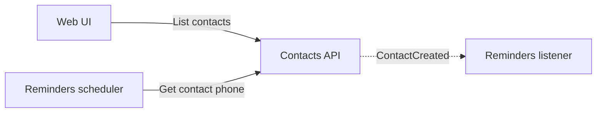
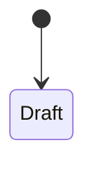
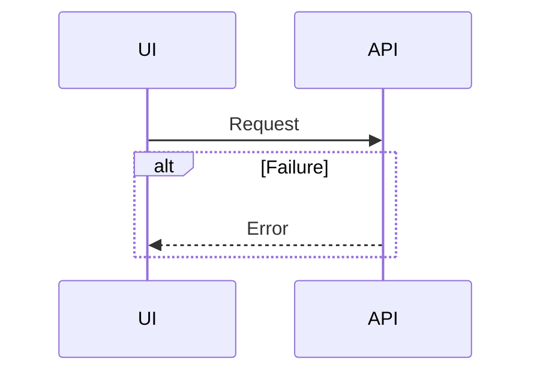

# <Feature Name>

> **How to use this template.** Discuss the feature with the owner until every question has an answer, then write the document once. Copy this file to `docs/<NNN>_FEATURES_<FEATURE_NAME_UPPER_CASE>.md`, keep its `##` headings exactly as they are, and fill in each `<…>`. Every line that starts with `>`, like this one, is guidance for the writer: delete all of them, so the finished document holds none. The document stays under 1,500 lines. A feature that needs more becomes two features.
>
> **Left out.** File paths, code, request and response fields, and test cases. How to implement and develop the feature, including where code goes, comes from the project structure and the guidelines in `AGENTS.md`, not from this document. The `.proto` contracts hold the API and event fields, and they are added in the same pull request as this document. The tests cover every case, and only an edge case the owner decides appears here, as one Decisions row.

**Submitted:** <YYYY-MM-DD> · **Status:** Draft · **Wireframe:** <the approved wireframe screens this feature changes, or "None">

> The owner marks the document Approved, and implementation starts only then. A new or changed Agent decision returns it to Draft.

## Summary

> At most five sentences on what the feature does, for whom, and why. Then one or more examples with real names and values, one line each. Add another example only when it shows something the first one does not.

<…>

**Example:** <such as "At 09:00 Dana opens the reminders screen and sees that the call with Avi, scheduled for 10:30, was sent to her phone at 09:30.">

## Scope

> Out lists what a reader might expect from this feature and does not get. The implementation agent builds nothing that is not In.

- **In:** <…>
- **Out:** <…>

## Decisions

> Each choice that had a real alternative gets a row, including every answer the owner gave in the planning discussion. Decided by says Owner only for what the owner said. The owner's approval accepts the Agent rows. The document never holds an open question.

| # | Decision | Why | Decided by |
|---|---|---|---|
| D1 | <…> | <…> | <Owner or Agent> |

## Components

> One high-level diagram of who talks to whom, covering the components this feature adds or changes and the ones they talk to. Solid arrows are synchronous calls, and dotted arrows are domain events. Every arrow has a label that says what it carries, such as the operation called or the event name. Then one row for each component the feature adds or changes. Tier is Module, Lib, Executable, Deployable, or Screen. A screen is named by its URL.

| Component | Tier | New or changed | Its job in this feature |
|---|---|---|---|
| <…> | <Module, Lib, Executable, Deployable, or Screen> | <New or Changed> | <…> |

## Domain Model

> Only what the feature adds or changes. Each aggregate starts with one sentence on what it is for, with an example. Type names the kind of value, such as Text, Whole number, Enum: …, Entity: …, or Value object: …. Invariants are the business rules that must never be broken, and the tests break each one on purpose. An aggregate with a status gets a state diagram. Operations name the RPC from the contract and say who calls it.

### <Aggregate>

<What it is for, with an example.>

| Field | Type | Meaning |
|---|---|---|
| <…> | <…> | <…> |

**Invariants:**

- <such as "A reminder is never scheduled before the moment it is created.">

| Operation | RPC | Caller | What it does |
|---|---|---|---|
| <…> | <`Service.Method`> | <…> | <…> |

## Events

> Each domain event the feature publishes or starts listening to. A subscriber's failure never blocks or rolls back the publisher. Write "None" when the feature has no events.

| Event | Published by | When | Subscribers and what they do |
|---|---|---|---|
| <…> | <…> | <…> | <…> |

## Flows

> Each main flow gets one sequence diagram, with its failures as `alt` blocks. A feature has at most three flows.

### <Flow name>

## Failures and Recovery

> Each row names one point where a crash or an outside failure leaves something behind, and how the system recovers with nothing lost and nothing applied twice. A feature without processes, queues, or outside calls writes "None:" and the reason.

| What fails | What is left | How it recovers |
|---|---|---|
| <…> | <…> | <…> |

## Implementation Plan

> The slices in build order. Each slice leaves the verification command green and can be reviewed on its own. The agent marks a slice Done when it lands.

| Slice | Delivers | Status |
|---|---|---|
| S1 | <…> | Planned |
